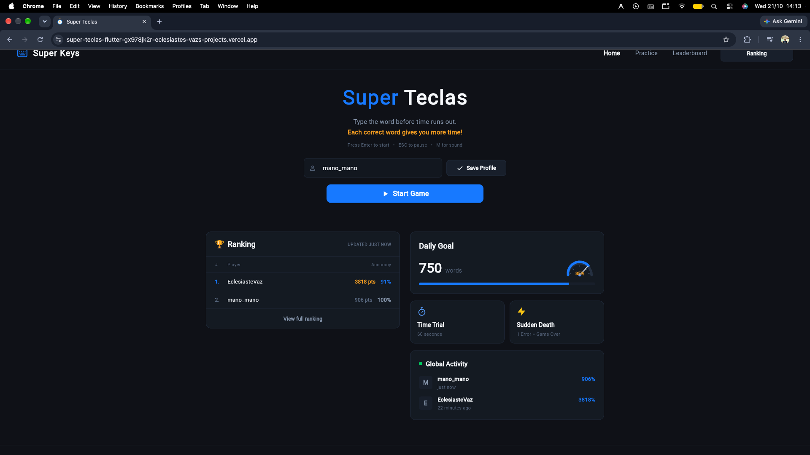
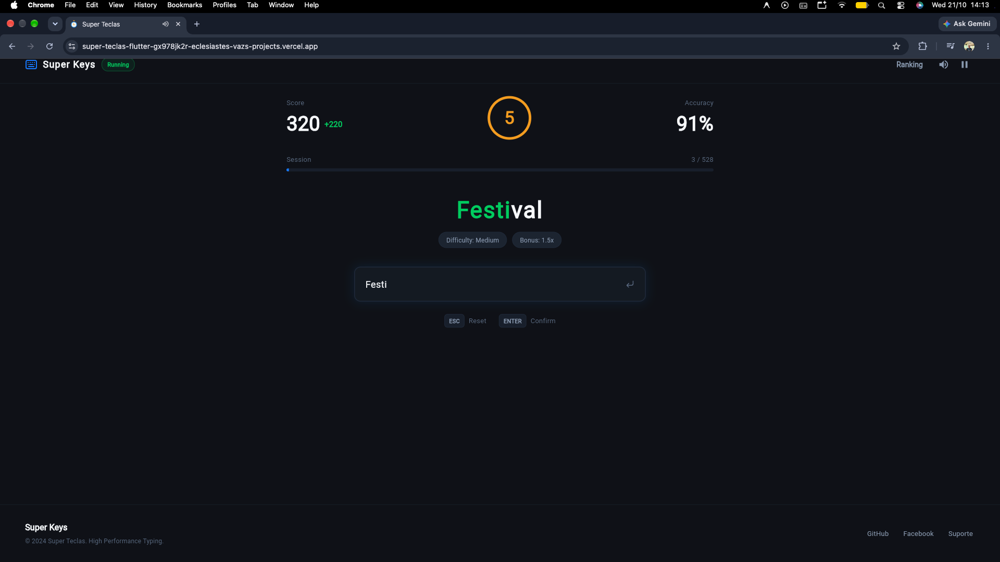
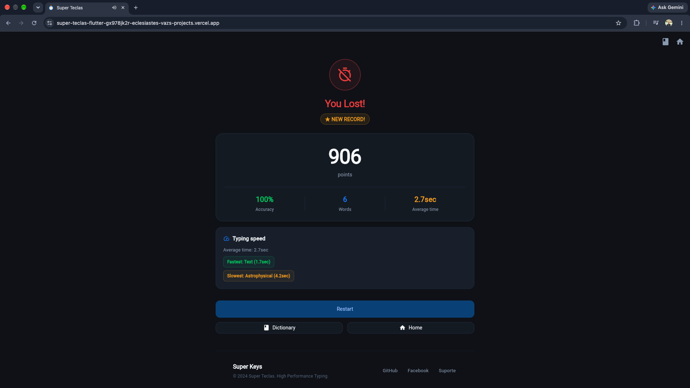
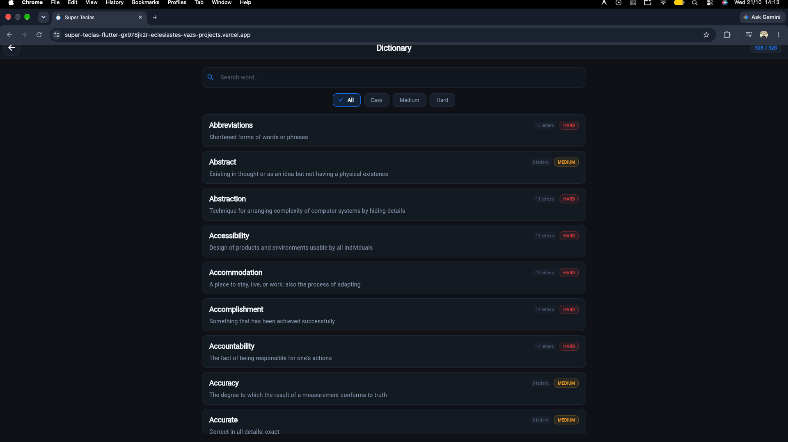
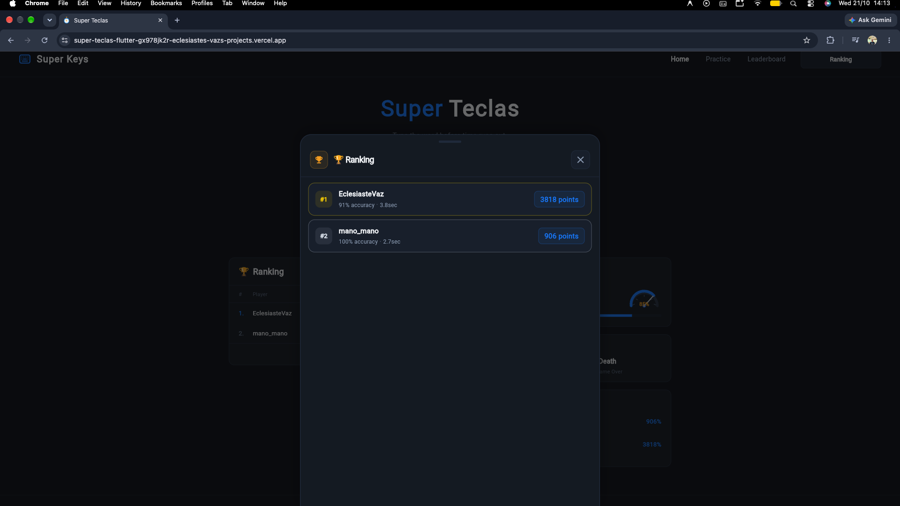

<div align="center">

# Super Teclas

**A fast-paced typing game against the clock.**

Challenge yourself to type words accurately before time runs out. Compete on the global online ranking, improve your speed and precision, and master words in both **Portuguese** and **English**.

[](https://super-teclas-flutter.vercel.app/)

[](https://flutter.dev)
[](https://dart.dev)
[](LICENSE)
[]()

</div>

---

## Features

- **Dual Language** — Full support for Portuguese and English with automatic locale detection
- **500+ Words per Language** — Curated word banks across 3 difficulty levels (easy, medium, hard)
- **Real-time Feedback** — Character-by-character coloring as you type (green = correct, red = wrong)
- **Countdown Timer** — Color-coded urgency: green (>5s), orange (>3s), red (≤3s)
- **Online Ranking & Anti-Cheat** — Firebase Firestore + Anonymous Auth + Server-side validation via Vercel Serverless Functions
- **Score & Stats** — Unified difficulty + speed-bonus scoring, accuracy, words per minute, and words completed
- **Background Music** — Immersive audio with victory/defeat sound effects
- **Pause & Mute** — Strict game states (`running`, `paused`, `finished`), word blurring on pause, max 3 pauses per match
- **Confetti Animation** — Custom-built celebration with 60-particle `CustomPainter` effect
- **PWA Ready** — Installable as a Progressive Web App with offline capabilities
- **Responsive Design** — Adapts to different screen sizes across all platforms

---

## Screenshots

| Home & Real-time Ranking | Active Gameplay | End Game & Performance |
|:---:|:---:|:---:|
|  |  |  |

| Vocabulary Dictionary | Global Ranking Modal |
|:---:|:---:|
|  |  |

---

## Tech Stack

| Layer | Technology |
|-------|------------|
| Framework | [Flutter](https://flutter.dev) (stable) |
| Language | [Dart](https://dart.dev) 3.5+ |
| State Management | `ChangeNotifier` + `ListenableBuilder` (no external packages) |
| Backend | [Firebase](https://firebase.google.com) (Cloud Firestore + Anonymous Auth) + Vercel Serverless Functions |
| Local Storage | [SharedPreferences](https://pub.dev/packages/shared_preferences) |
| Audio | [audioplayers](https://pub.dev/packages/audioplayers) 5.2.1 |
| i18n | Custom `InheritedWidget` + `AppStrings` (PT/EN) |
| Deployment | [Vercel](https://vercel.com) (web + `/api/*`) & GitHub Actions CI/CD |

---

## Getting Started

### Prerequisites

- **Flutter SDK** — [Install Flutter](https://docs.flutter.dev/get-started/install) (stable channel, ≥3.38.4)
- **Dart SDK** — Comes bundled with Flutter (≥3.5.0)
- **IDE** — [VS Code](https://code.visualstudio.com/) with Flutter extension, or [Android Studio](https://developer.android.com/studio)
- **Firebase Account** — Spark Free Plan at [firebase.google.com](https://firebase.google.com) (for online words, game telemetry, and ranking)

### Installation

1. **Clone the repository**

   ```bash
   git clone https://github.com/your-username/super-teclas-flutter.git
   cd super-teclas-flutter
   ```

2. **Install dependencies**

   ```bash
   flutter pub get
   ```

3. **Configure Environment Variables** (optional — game works offline with local word bank fallback)

   Copy the `.env.example` template:

   ```bash
   cp .env.example .env
   ```

   Fill in your Firebase and API credentials in `.env`:
   ```env
   FIREBASE_API_KEY=your-firebase-api-key
   FIREBASE_APP_ID=your-firebase-app-id
   FIREBASE_PROJECT_ID=your-firebase-project-id
   FIREBASE_MESSAGING_SENDER_ID=your-messaging-sender-id
   FIREBASE_STORAGE_BUCKET=your-project.appspot.com
   FIREBASE_AUTH_DOMAIN=your-project.firebaseapp.com
   FIREBASE_MEASUREMENT_ID=your-measurement-id
   API_BASE_URL=https://your-project.vercel.app
   ADMIN_SEED_TOKEN=your-secret-admin-seed-token
   ```

   See [COMPETITION.md](COMPETITION.md) for detailed Firebase setup, Firestore rules, and serverless endpoints.

4. **Run the app**

   **Option A: Web (using `.env`)**
   ```bash
   flutter run -d chrome --dart-define-from-file=.env
   # or with npm script:
   npm run run:web
   ```

   **Option B: Mobile / Desktop (using `.env`)**
   ```bash
   # Android / iOS / macOS / Linux / Windows
   flutter run --dart-define-from-file=.env
   ```

   **Option C: VS Code / IDE**
   Just press **F5** (Run/Debug) — `.vscode/launch.json` is preconfigured to load `.env` automatically.

5. **Deploy to Vercel (Local Deploy)**

   Compile and deploy directly from your machine without committing build artifacts or keys:
   ```bash
   npm run deploy
   ```

---

## Project Structure

```
super-teclas-flutter/
├── lib/
│   ├── main.dart                              # Entry point, locale, theme, Firebase init
│   └── src/
│       ├── config/
│       │   └── env.dart                       # Environment configuration (.env / --dart-define)
│       ├── data/
│       │   ├── i18n/
│       │   │   └── app_strings.dart           # 60+ translated strings (PT/EN)
│       │   ├── models/
│       │   │   ├── game_session_model.dart    # GameStatus, GameWordLog, anti-cheat validation
│       │   │   └── word_model.dart            # WordModel with difficulty & speed bonus points
│       │   └── words/
│       │       └── word_bank.dart             # Firestore + JSON word loader with fallback
│       ├── services/
│       │   ├── game_service.dart              # Core game logic (ChangeNotifier)
│       │   ├── ranking_service.dart           # Firebase ranking & session telemetry
│       │   └── storage_service.dart           # Local username & userId storage
│       └── ui/
│           ├── pages/
│           │   ├── dictionary_page.dart       # Vocabulary browser
│           │   ├── home_page.dart             # Home screen with ranking
│           │   ├── game_page.dart             # Main gameplay screen
│           │   └── end_game_page.dart         # Results with confetti
│           └── widgets/
│               ├── button_custom_widget.dart  # Reusable styled button
│               ├── ranking_modal.dart         # Paginated leaderboard modal
│               └── title_game_widget.dart     # Two-tone title widget
├── api/
│   ├── register-words.js                      # Serverless word registration endpoint
│   └── validate-game.js                       # Serverless anti-cheat game validator
├── scripts/
│   └── seed_words.mjs                         # CLI script to seed PT/EN words
├── firestore.rules                            # Cloud Firestore security rules
├── test/
│   ├── game_service_test.dart                 # Unit tests for game logic & anti-cheat
│   ├── word_model_test.dart                   # Unit tests for word model & scoring
│   ├── ranking_service_test.dart              # Unit tests for ranking service
│   ├── widget_test.dart                       # Widget tests for HomePage
│   ├── game_page_test.dart                    # Widget tests for GamePage
│   └── end_game_page_test.dart                # Widget tests for EndGamePage
├── assets/
│   ├── audios/                                # Background music + SFX
│   ├── images/                                # App icon
│   └── words/
│       ├── pt.json                            # Portuguese words
│       └── en.json                            # English words
├── web/                                       # Web config, PWA manifest, icons
├── android/                                   # Android platform config
├── ios/                                       # iOS platform config
├── linux/                                     # Linux platform config
├── windows/                                   # Windows platform config
├── pubspec.yaml
├── vercel.json
├── AGENTS.md                                  # Agent instructions for AI assistants
└── COMPETITION.md                             # Online ranking system documentation
```

---

## Architecture

### State Management

The game uses Flutter's built-in `ChangeNotifier` pattern — no external state management packages:

- **`GameService`** — Core game state (words, score, accuracy, timer). Extends `ChangeNotifier` and notifies listeners on every mutation.
- **`ListenableBuilder`** — UI subscribes to `GameService` changes for reactive updates.
- **`LocaleProvider`** — `InheritedWidget` that injects locale into the widget tree.

### Data Flow

```
User Input (onChanged)
    │
    ├── recordKeystroke()        → totalKeystrokes++ (only when running)
    ├── addCorrectKeystroke()    → correctKeystrokes++ (if matches & running)
    └── writing(word)            → validate → award points + log telemetry → advance word → check win
                                         │
                                         └── notifyListeners() → UI rebuilds
```

### Game Mechanics

| Metric | Formula |
|--------|---------|
| Score per Word | Base (`easy`: 100, `medium`: 150, `hard`: 200) + speed bonus (up to +50% based on `expectedDurationMs` vs `actualDurationMs`) |
| Accuracy | `(correctKeystrokes / totalKeystrokes) × 100` |
| Words/min | `(wordsCompleted / activeElapsedSeconds) × 60` |
| Timer | `word.length.clamp(8, 15)` seconds per word |

### Navigation

All navigation uses `Navigator.pushReplacement` — each screen replaces the previous one (no back stack):

```
HomePage → GamePage → EndGamePage → (restart or home)
```

---

## Configuration

### Firebase & Vercel Serverless (Online Words, Game Validation & Ranking)

1. Create a Firebase project at [console.firebase.google.com](https://console.firebase.google.com) (Spark free plan)
2. Enable **Cloud Firestore** and **Authentication → Anonymous**
3. Deploy `firestore.rules` to your Firestore database
4. Configure environment variables in Vercel (`FIREBASE_SERVICE_ACCOUNT_JSON`, `ADMIN_SEED_TOKEN`) and GitHub Actions Secrets
5. Seed words into Firestore via `API_BASE_URL=https://your-project.vercel.app ADMIN_SEED_TOKEN=your-token npm run seed:words`

The game works fully offline — word bank and ranking features gracefully degrade when Firebase is unavailable.

### Adding Words

Edit the JSON files in `assets/words/` or register them directly in Firestore via `POST /api/register-words`:

```json
[
  {"word": "YourWord", "difficulty": "easy|medium|hard", "definition": "..."}
]
```

Each language has ~500 words. The `WordBank` loads from Firestore first, falls back to bundled JSON assets, and includes a hardcoded fallback of 16 words per language.

---

## Testing

### Run All Tests

```bash
flutter test
```

### Run Specific Test Files

```bash
flutter test test/game_service_test.dart       # Unit tests
flutter test test/word_model_test.dart         # Model tests
flutter test test/widget_test.dart             # HomePage widget tests
flutter test test/game_page_test.dart          # GamePage widget tests
flutter test test/end_game_page_test.dart      # EndGamePage widget tests
```

### Test Coverage

```bash
flutter test --coverage
genhtml coverage/lcov.info -o coverage/html
open coverage/html/index.html
```

### Test Approach

- **Unit tests** — Game logic, states (`running`, `paused`, `finished`), anti-cheat validation, word model, unified scoring
- **Widget tests** — UI rendering, navigation, pause state blurring, audio mocking
- Audio channels are always mocked (`setMockMethodCallHandler`) — no real audio in tests
- Each test file has its own `_buildApp()` helper with localization delegates

---

## Deployment

### Web (Vercel / GitHub Actions)

```bash
flutter build web --release \
  --dart-define=FIREBASE_API_KEY=your-firebase-api-key \
  --dart-define=FIREBASE_APP_ID=your-firebase-app-id \
  --dart-define=FIREBASE_PROJECT_ID=your-firebase-project-id \
  --dart-define=FIREBASE_MESSAGING_SENDER_ID=your-messaging-sender-id \
  --dart-define=FIREBASE_STORAGE_BUCKET=your-project.appspot.com \
  --dart-define=FIREBASE_AUTH_DOMAIN=your-project.firebaseapp.com \
  --dart-define=API_BASE_URL=https://your-project.vercel.app

vercel --prod
```

The `vercel.json` is configured to serve `build/web` and route `/api/*` serverless functions (`api/register-words.js` and `api/validate-game.js`).

### Android

```bash
flutter build apk --release
```

### iOS

```bash
flutter build ios --release
```

### Desktop

```bash
flutter build linux --release
flutter build windows --release
```

---

## Contributing

Contributions are welcome! Here's how to get started:

1. **Fork** the repository
2. **Create** a feature branch (`git checkout -b feat/my-feature`)
3. **Commit** your changes (`git commit -m 'feat: add my feature'`)
4. **Push** to the branch (`git push origin feat/my-feature`)
5. **Open** a Pull Request

### Development Guidelines

- Follow the code conventions in [AGENTS.md](AGENTS.md)
- Run `flutter analyze` before submitting
- Run `flutter test` to ensure all tests pass
- No external state management packages (keep it pure Flutter)
- No comments in code unless explicitly requested
- Use `package:` imports (absolute), never relative imports
- Add tests for new features

---

## Roadmap

- [x] Server-side score & anti-cheat validation (`/api/validate-game`)
- [x] Firebase Anonymous Auth + Firestore words & games telemetry
- [x] Dedicated ranking modal with pagination
- [ ] Difficulty selection (easy/medium/hard)
- [ ] Language-specific ranking filters
- [ ] Sound toggle persistence

---

## License

This project is licensed under the MIT License — see the [LICENSE](LICENSE) file for details.

---

## Acknowledgments

- [Flutter](https://flutter.dev) — Beautiful, fast UI framework
- [Firebase](https://firebase.google.com) — Cloud Firestore & Authentication
- [audioplayers](https://pub.dev/packages/audioplayers) — Cross-platform audio playback
- Word audio credits: [Freesound](https://freesound.org) for sound effects

---

<div align="center">

**Built with Flutter**

</div>
